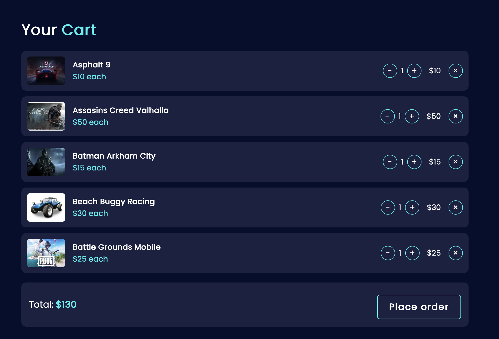
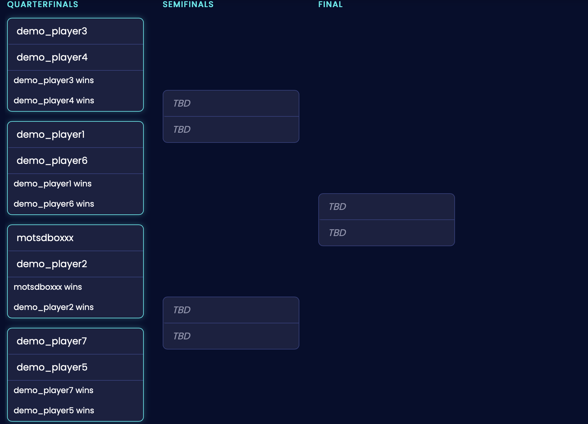

# GamersLounge

A full-stack game store and tournament platform. Players browse a catalog of PC and mobile games, buy them through a cart, and compete in single-elimination tournaments with live brackets. Admins manage games, orders, messages and tournaments.

> **Live demo:** _coming soon_

## Screenshots

| Store | Cart and orders |
|---|---|
|  |  |

| Tournament bracket |
|---|
|  |

## Features

- **Accounts:** sign up, log in and log out, with hashed passwords and JWT sessions in an httpOnly cookie
- **Store:** 20 games from the database, with platform filter, live search (title or genre), sorting and pagination
- **Cart and orders:** a cart that survives login, and checkout that creates a real order. Prices are looked up on the server, so the client can never set its own price
- **Tournaments:** players join and leave while registration is open. Starting a tournament randomly seeds the players and draws a single-elimination bracket, with byes when the player count isn't a power of two. Reporting a result advances the winner until a champion is crowned. The bracket refreshes live for everyone watching
- **Admin tools:** create, edit and soft-delete games, manage news, mark orders paid or cancelled, create and run tournaments, and read the contact-form inbox
- **Contact form:** messages go to an admin-only inbox, rate limited to 5 per hour per visitor
- **Responsive:** works from phone to wide desktop

## Tech stack

| Layer | Tools |
|---|---|
| Server | Node.js 22, Express 5 |
| Database | SQLite (better-sqlite3), foreign keys and transactions |
| Auth and security | bcrypt, JWT, helmet (CSP), rate limiting, zod input validation |
| Front end | Plain HTML, CSS and JavaScript (no framework), served by the same server |
| Testing | Node's built-in test runner: 23 tests covering the API, auth rules and bracket logic. The UI was also tested end to end in a real browser (Playwright) |

## Run it locally

You need Node.js 22 or newer.

```bash
git clone https://github.com/mr-mots/gamerslounge.git
cd gamerslounge
npm install
npm start
```

Then open http://localhost:3000. The first run creates and seeds the database, plus a development admin account: `admin@gamerslounge.dev` / `admin12345`. For anything real, copy `.env.example` to `.env` and set `JWT_SECRET`, `ADMIN_EMAIL` and `ADMIN_PASSWORD`.

Game cover art is not included for copyright reasons. Put your own images in `public/images/` (the expected file names are listed in `src/seed.js`).

```bash
npm test                  # run the 23 tests
node src/demo.js          # fill the first open tournament with 7 demo players
node src/demo.js 2 12     # add 12 demo players to tournament #2
```

Demo accounts are `demo_player1`, `demo_player2`, ... with the password `password123`. Log in as the admin, open Tournaments, press **Start tournament** and report the results.

## How the tournament engine works

Single elimination. When an admin starts a tournament, players are shuffled into seeds and `src/bracket.js` builds every round. Standard seeding keeps seeds 1 and 2 apart until the final, and if the number of players is not a power of two the top seeds get byes into round 2. Reporting a result moves the winner into the next match, and the tournament completes when the final is decided. All writes happen inside database transactions, so a bracket can never be left half updated.

## API

Errors are always JSON: `{ "error": "message", "details": [...] }`.

| Method | Path | Access | Notes |
|---|---|---|---|
| POST | `/api/auth/register` | public | `username`, `email`, `password` (8+ chars) |
| POST | `/api/auth/login` | public | returns `{ user, token }` and sets an httpOnly cookie |
| POST | `/api/auth/logout` | public | clears the cookie |
| GET | `/api/auth/me` | user | |
| GET | `/api/games` | public | `?platform=pc\|mobile&genre=&q=&sort=title\|price_asc\|price_desc\|newest&page=&limit=` |
| GET | `/api/games/:idOrSlug` | public | |
| POST / PATCH / DELETE | `/api/games[/:id]` | admin | DELETE is a soft delete, so old orders still show the game |
| GET | `/api/news`, `/api/news/:id` | public | `?tag=&page=&limit=` |
| POST / DELETE | `/api/news[/:id]` | admin | |
| POST | `/api/orders` | user | `{ items: [{ gameId, quantity }] }`, prices come from the database |
| GET | `/api/orders` | user | your orders (`?all=true` for admins) |
| GET | `/api/orders/:id` | owner/admin | |
| PATCH | `/api/orders/:id/status` | admin | `pending`, `paid`, `cancelled`, `refunded` |
| POST | `/api/contact` | public | `name`, `email`, `message` |
| GET | `/api/contact/messages` | admin | `?unread=true` |
| PATCH | `/api/contact/messages/:id/read` | admin | |
| GET | `/api/tournaments` | public | `?status=open\|in_progress\|completed` |
| GET | `/api/tournaments/:id` | public | players, seeds and every match |
| POST | `/api/tournaments` | admin | `name`, `gameId?`, `maxPlayers` (2-64), `startsAt?` |
| POST | `/api/tournaments/:id/join`, `/leave` | user | only while registration is open |
| POST | `/api/tournaments/:id/start` | admin | seeds players and builds the bracket |
| POST | `/api/tournaments/:id/matches/:matchId/result` | admin | `{ winnerId }` |

## Project structure

```
public/                   front end: HTML pages, style.css, account.css, js/
src/
  app.js                  Express app (security headers, rate limits, routes)
  server.js               entry point
  db.js                   SQLite schema
  seed.js                 games, news, tournaments and the admin account
  auth.js, errors.js      JWT middleware and error helpers
  bracket.js              pure bracket logic
  tournamentService.js    tournament rules, all writes in transactions
  demo.js                 adds demo players to a tournament
  routes/                 one file per resource
test/                     API, tournament and bracket tests
```

## Limitations and next steps

- Checkout saves orders as `pending`. Payments are not connected yet. The plan is Stripe Checkout in test mode, with a webhook that marks the order paid.
- The content security policy still allows inline scripts because the original pages use them. They should move into `.js` files so that allowance can be removed.
- Planned: an AI game recommender that suggests games from the catalog.
